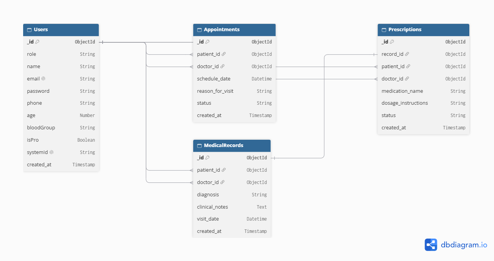

# VitalSync — Enterprise EHR & Clinical Operations Platform

> Commercial-Grade Electronic Health Record (EHR) and Clinical Management Solution.

**Track Declaration:** Track B (Fullstack Developer) - MERN Stack Focus

## 🔗 Deployment & Repository Links

- **Frontend App (Vercel):** [https://vital-sync-clinical.vercel.app](https://vital-sync-clinical.vercel.app)
- **Backend API (Render):** [https://prodesk-capstone-vitalsync-backend.onrender.com](https://prodesk-capstone-vitalsync-backend.onrender.com)
- **GitHub Repository:** [https://github.com/Shivam-hub976/Prodesk-Capstone-VitalSync](https://github.com/Shivam-hub976/Prodesk-Capstone-VitalSync)

---

## 1. Executive Summary & Vision

**VitalSync** is an enterprise-grade Electronic Health Record (EHR) and hospital management interface designed to modernize clinical workflows. The platform bridges the gap between patient engagement and medical administration by providing unified, role-based access to medical histories, appointment scheduling, and digital prescriptions.

**Project Vision:** To architect a highly scalable, secure, and intuitive digital healthcare ecosystem that minimizes administrative friction and maximizes clinical efficiency.

### Target Performance KPIs

- **Lighthouse Performance Score:** 100/100 across Performance, Accessibility, Best Practices, and SEO.
- **Mobile-First Responsiveness:** Pixel-perfect fluid layouts across mobile (320px+), tablet, and desktop viewports.
- **State Management:** Zero unnecessary UI re-renders during complex state mutations (e.g., appointment booking, calendar grid updates) achieved via Zustand.
- **Security & Reliability:** Strict Role-Based Access Control (RBAC) ensuring decoupled state access and route protection for Patients, Doctors, and Admins. Protected by `.env` injected Authorization Keys for staff onboarding.

## 2. Role-Based Access Control (RBAC) & User Personas Matrix

VitalSync relies on strict role isolation. The UI and data access layers are completely decoupled based on the authenticated user's assigned role.

### User Personas

1. **The Patient:** Seeking medical care. Needs low-friction access to book appointments, view their personal medical history timelines, and download digital prescriptions.
2. **The Doctor:** Providing clinical care. Needs high-efficiency dashboards to view their daily appointment queue, author clinical notes, and generate prescriptions.
3. **The Administrator (Owner):** Managing hospital operations. Needs oversight of all staff, department scheduling, appointment modifications (Date/Time/Reason edits), and platform audit logs.

### Access Control Matrix

| Feature Module                 |     Patient      |      Doctor      | Administrator |
| :----------------------------- | :--------------: | :--------------: | :-----------: |
| **Personal Health Timeline**   |   ✅ View Own    | ✅ View Assigned |  ✅ View All  |
| **Appointment Booking**        | ✅ Create/Cancel |  ❌ Restricted   | ✅ Manage All |
| **Appointment Modifications**  |  ❌ Restricted   |  ❌ Restricted   | ✅ Full Edit  |
| **Doctor Availability Grid**   |   ✅ View Only   |  ✅ Manage Own   | ✅ Manage All |
| **Clinical Notes & Diagnoses** |  ❌ Restricted   |  ✅ Create/Edit  |   ✅ Create   |
| **Digital Prescriptions**      | ✅ Download Own  | ✅ Generate/Sign |  ✅ Generate  |
| **Staff & Role Management**    |  ❌ Restricted   |  ❌ Restricted   | ✅ Full CRUD  |

## 3. Tech Stack & Engineering Architecture

VitalSync is architected using a modern, decoupled web architecture designed for modularity, rapid UI performance, and zero-downtime scalability.

### Core Technology Stack

- **Frontend Framework:** React 18+ (Vite)
- **Styling Architecture:** Tailwind CSS with CSS Variables for dynamic Dark/Light theme toggles
- **Component Primitives:** Custom Headless UI components with Lucide React Iconography
- **State Management:** Zustand (Decoupled store for RBAC state and calendar grid updates)
- **Payment Gateway:** Stripe API Integration (Pro Upgrades via Checkout Sessions)
- **Backend Runtime:** Node.js & Express.js (RESTful API architecture)
- **Database & Persistence:** MongoDB Atlas with Mongoose ORM
- **Deployment Strategy:** Vercel (Frontend Client) & Render (Backend REST API)

### Architecture Principles

1. **Component Modularization:** Clean separation of concerns with atomic design (`components/auth`, `components/dashboard`).
2. **Optimistic UI Updates:** UI state mutations (e.g., deleting appointments) execute instantly before backend resolution, ensuring a snappy user experience.
3. **Enterprise Security Validation:** Use of Authorization Secret Keys during staff (Doctor/Admin) registration to prevent unauthorized privilege escalation.

## 4. Database Schema & Entity Relationship Diagram (ERD)

The VitalSync database architecture utilizes MongoDB. While NoSQL is document-based, we maintain strict relational integrity between patients, doctors, and their associated clinical data using object references.

### Core Collections

1. **Users:** Stores authentication credentials, profiles, RBAC roles, System IDs (e.g., PAT-001), and demographic settings.
2. **Appointments:** Manages the scheduling grid, linking a Patient to a Doctor with status workflows (Pending, Scheduled, Completed, Cancelled).
3. **MedicalRecords:** The chronological clinical history containing diagnoses and physician notes.
4. **Prescriptions:** Digital medication orders linked to specific medical records and patients.

### Schema Definition (DBML)

```dbml
Table Users {
  _id ObjectId [pk]
  role String [note: 'patient, doctor, admin']
  name String
  email String [unique]
  password String
  phone String
  age Number
  bloodGroup String
  isPro Boolean
  systemId String [unique]
  created_at Timestamp
}

Table Appointments {
  _id ObjectId [pk]
  patient_id ObjectId [ref: > Users._id]
  doctor_id ObjectId [ref: > Users._id]
  schedule_date Datetime
  reason_for_visit String
  status String [note: 'pending, scheduled, completed, cancelled, rejected']
  created_at Timestamp
}

Table MedicalRecords {
  _id ObjectId [pk]
  patient_id ObjectId [ref: > Users._id]
  doctor_id ObjectId [ref: > Users._id]
  diagnosis String
  clinical_notes Text
  visit_date Datetime
  created_at Timestamp
}

Table Prescriptions {
  _id ObjectId [pk]
  record_id ObjectId [ref: - MedicalRecords._id]
  patient_id ObjectId [ref: > Users._id]
  doctor_id ObjectId [ref: > Users._id]
  medication_name String
  dosage_instructions String
  status String [note: 'active, dispensed']
  created_at Timestamp
}
```

### Entity-Relationship Diagram (ERD)



## 5. API Endpoint Contracts & Global Client State Tree

### RESTful API Endpoint Specifications

#### Authentication & User Management

- `POST /api/auth/register` — Register new user (Staff requires VITALSYNC_SECRET_KEY)
- `POST /api/auth/login` — Authenticate credentials and return JWT token
- `GET /api/auth/me` — Retrieve currently authenticated user profile
- `PUT /api/auth/profile` — Update user profile & settings
- `GET /api/auth/doctors` — Fetch all doctors (Protected)
- `GET /api/auth/patients` — Fetch all patients (Admin Protected)
- `PUT /api/auth/users/:id` — Update any user profile (Admin Protected)
- `DELETE /api/auth/users/:id` — Delete any user (Admin Protected)

#### Appointments Engine

- `GET /api/appointments` — Fetch contextual list of appointments
- `POST /api/appointments` — Create a new appointment booking (Admin can select target patient)
- `PATCH /api/appointments/:id/status` — Update appointment state (status, schedule_date, reason)
- `DELETE /api/appointments/:id` — Cancel/Remove appointment

#### EHR Medical Records & Prescriptions

- `GET /api/ehr/medical-records/patient/:patientId` — Retrieve medical history
- `POST /api/ehr/medical-records` — Author new clinical note
- `GET /api/ehr/prescriptions/patient/:patientId` — Fetch active digital prescriptions
- `POST /api/ehr/prescriptions` — Issue digital prescription

#### Monetization Gateway

- `POST /api/payments/create-checkout-session` — Generate Stripe checkout URL
- `POST /api/payments/verify` — Validate session and grant isPro status

### Global Client State Tree (Zustand Store)

To avoid excessive prop-drilling and unnecessary re-renders across dashboard views, client state is organized into isolated slices:

**Plaintext**

```text
RootStateStore
├── themeStore
│   ├── theme: 'light' | 'dark'
│   └── toggleTheme(): void
│
├── appointmentStore
│   ├── appointments: Appointment[]
│   ├── isLoading: boolean
│   ├── fetchAppointments(): Promise<void>
│   ├── addAppointment(payload): Promise<void>
│   └── removeAppointment(id): Promise<void> (Features Optimistic Updates)
│
└── recordStore
    ├── activePatientHistory: MedicalRecord[]
    ├── activePrescriptions: Prescription[]
    ├── fetchPatientEHR(patientId): Promise<void>
    ├── addClinicalEntry(payload): Promise<void>
    └── addPrescription(payload): Promise<void>
```

## 6. Sprint Execution Roadmap

To ensure zero technical debt and manageable deliverables, development is divided across four distinct sprints:

- **Sprint 14 (MVP Foundation):** Initialize React (Vite) frontend and Node.js backend. Establish MongoDB connection, configure JWT authentication, and build basic RBAC routing.
- **Sprint 15 (Core CRUD Completion):** Implement the Appointment Engine, Doctor Dashboard queue, Patient Health Timeline, and Strict Data Ownership checks.
- **Sprint 16 (Advanced Features & UX Polish):** Integrate Optimistic UI Updates, Admin Management Modules, Authorization Key workflows, Stripe Mock Gateway, and Dark/Light mode UI polish.
- **Sprint 17 (CI/CD & Production Go-Live):** Final Lighthouse optimization audits, strict environment variable configuration, and deployment to Vercel (Frontend) and Render (Backend).

## 7. Visual Asset & UI/UX Strategy

**Design Tooling:** High-fidelity DOM wireframing via Figma mapping at least 3 core viewports (Auth, Patient Dashboard, Doctor Console).

**Responsive Guidelines:** All interfaces will adopt a mobile-first Tailwind configuration, ensuring fluid layouts before scaling to tablet/desktop breakpoints.

**Media & Assets:** Placeholder medical imagery and user avatars will be dynamically sourced from Unsplash using high-quality, professional search queries.

**Favicon:** The application utilizes a 100% lightweight, scalable inline SVG favicon configured at the document root to eliminate extra network requests.

### UI/UX Wireframes (Figma)

The low-fidelity DOM wireframes for the core viewports (Authentication, Doctor Console, and Patient EHR) have been mapped to ensure strict layout adherence during the frontend development phase.

- **[View VitalSync Figma Wireframes Here](https://www.figma.com/design/S4T77qVAGEKMaCLpilYL2q/Untitled?node-id=0-1&t=SFZ9mZ8bBscwNHNc-1)**
